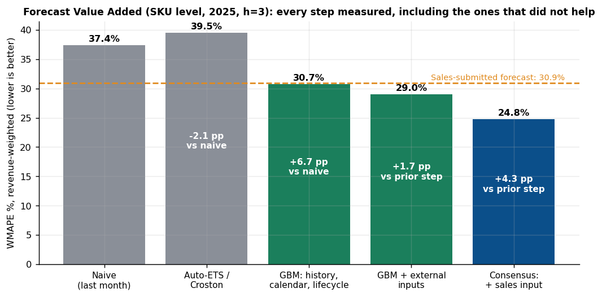
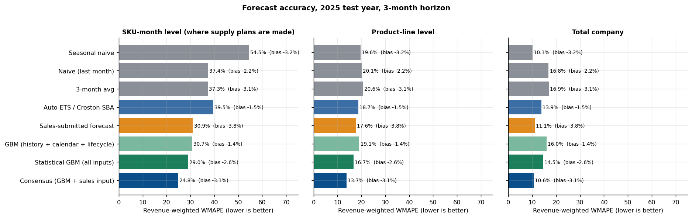
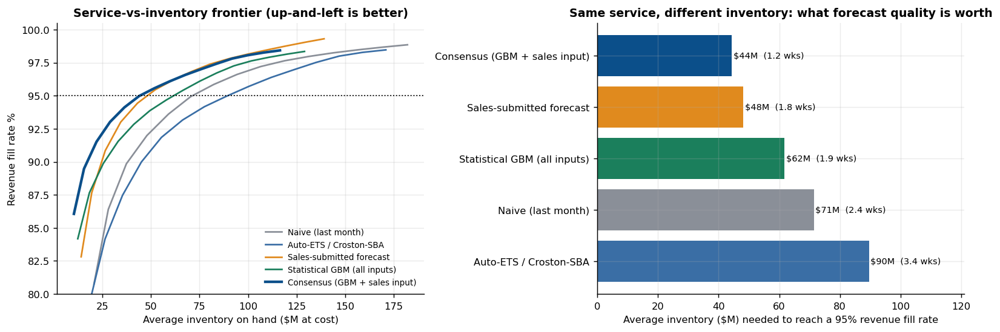

# Forecasting & S&OP Planning

**Demand forecasting and consensus S&OP simulation for a fictional hardware company (PCs, storage, network switches, servers, edge sensors, accessories).**

> **Synthetic data.** "Meridian Systems" and every number in this repository are simulated. Nothing here comes from, or says anything about, a real company or employer. Results show how the methods behave on data with known structure; they are not claims about real-world performance. See [Limitations](#limitations).

## The problem

A hardware company must commit to builds and component purchases **about three months before** it knows real demand. Order too much and cash is trapped in inventory; too little and sales are lost. The monthly S&OP cycle exists to agree *one* demand plan across Sales, Marketing, Finance, Product and Supply Chain.

This project builds that whole loop end to end, then asks the question planners are measured on: **did each step of the forecast process make the forecast better, and what is that worth in inventory and service?**

## What goes in

36 SKUs, 6 product lines, 72 months of history, and the inputs a planning team really juggles:

| Input | Examples | Owner |
|---|---|---|
| Sales history | Orders (unconstrained demand), shipments (supply-capped), backlog | Sales ops |
| Product roadmap | Launches, end-of-life, last-time-buy, generation overlap | Product |
| Seasonality | Quarter-end peaks (enterprise), back-to-school and holiday (consumer) | - |
| Marketing & promotions | Planned promo calendar and depth, marketing budget plan, campaigns | Marketing |
| Competitors | Price index, relative price, product launches, share estimates | Competitive intel |
| Macro | IT-capex and consumer indices, memory/commodity prices | Finance |
| Supply chain & operations | Supplier lead time, allocation, on-time delivery, yield, CM capacity | Supply chain / Ops |
| Leading indicator | Sales-pipeline index / web traffic | Sales ops / digital |
| Legacy forecast | Sales-submitted forecast made 3 months ahead | Sales |

Full detail: [`docs/data_dictionary.md`](docs/data_dictionary.md).

## What it does

```
history + calendar + roadmap + plans + external signals
        |
        v
 benchmarks (naive, seasonal naive, auto-ETS / Croston)      global GBM across all SKUs (cross-learning)
        |                                                           |
        +------------------ rolling-origin backtest ----------------+
                                      |
                    consensus = statistical GBM + sales input (weight set on 2024 only)
                                      |
        accuracy, bias, Forecast Value Added  ->  prediction intervals  ->  inventory vs service  ->  exceptions
```

* **Honest evaluation:** every model is re-trained at every forecast origin using only data available then; 2024 = validation, 2025 = test.
* **Right target:** forecasts *orders*, not shipments, because supply-capped shipments understate demand.
* **Right metrics:** revenue-weighted WMAPE **and** bias, measured at SKU, line and company level.
* **Forecast Value Added:** each process step is judged against the one before it, including steps that did not help.
* **Uncertainty:** P10-P90 intervals with conformal calibration for supply risk.
* **Business impact:** inventory needed for the *same* fill rate, per forecast source.
* **Governance:** ABC/XYZ segmentation, tracking signal, top-10 exception report.

## Headline results (2025 test year, 3-month horizon)



| SKU-level, revenue-weighted | WMAPE | Bias | Inventory needed for 95% fill rate |
|---|---|---|---|
| Naive (last month) | 37.4% | -2.2% | $71M |
| Auto-ETS / Croston-SBA | 39.5% | -1.5% | $90M |
| Sales-submitted forecast (simulated) | 30.9% | -3.8% | $48M |
| GBM: history + calendar + lifecycle | 30.7% | -1.4% | $67M |
| GBM: all inputs | 29.0% | -2.6% | $62M |
| **Consensus (GBM + sales input)** | **24.8%** | -3.1% | **$44M** |

* Consensus beats naive by **12.5 WMAPE points (95% interval 6.3 to 19.5)** and the sales forecast by **6.1 points (2.2 to 10.8)**; it needs **8% less inventory than the sales forecast and 38% less than naive** for the same 95% revenue fill rate.
* Giving the GBM the external inputs improves it by **1.7 points (0.3 to 3.5)** over history-only.
* P10-P90 intervals: raw quantile model covered **62%** of 2025 outcomes (over-confident); after conformal calibration **82.6%** against an 80% target.





## What did not work (reported on purpose)

* **Auto-ETS / Croston was worse than naive** on this trending, step-changing data.
* **The GBM alone is not significantly better than the sales forecast** (+1.8 points, interval -4.9 to +9.1) and needs 28% more inventory for the same service. Its value appears in the consensus.
* **At total-company level, seasonal naive (10.1%) matches the best model (10.6%).** Gains are at SKU and line level, where supply is planned.
* **Several external inputs added nothing:** in the seed-averaged ablation, removing the leading indicator, competitor or macro inputs did not hurt. Promotions, marketing and known events carried the value (0.3-0.8 points each).
* **At a 6-month horizon, all-inputs GBM (42.1%) was worse than history-only (38.6%).**
* **Volatile SKUs** are the model's weak spot (42.5% WMAPE vs 30.9% for the sales forecast).

Full discussion: [`docs/methodology.md`](docs/methodology.md).

## Run it

```bash
pip install -r requirements.txt
python src/generate_data.py          # writes data/raw/*.csv and data/processed/panel.csv
python src/run_all.py                # backtest (~2 min) + metrics + ablation + figures  (~5 min total on a laptop)
python src/run_all.py --cached       # rebuild tables and figures from the saved backtest (~2 min)
jupyter notebook notebooks/forecasting_and_sop_planning.ipynb
```

Outputs: `outputs/tables/*.csv`, `outputs/figures/*.png`, `outputs/results_summary.json`.

## Repository layout

```
data/raw/            generated source tables (sales, SKU master, promos, marketing, competitor, macro, supply chain, ops, events)
data/processed/      panel.csv - SKU-month modelling table
src/generate_data.py synthetic data-generating process (documented assumptions)
src/features.py      loading and leakage-safe feature engineering (origin vs plan features)
src/models.py        naive family, auto-ETS, Croston-SBA, global LightGBM
src/evaluate.py      rolling-origin backtest, metrics, FVA, intervals, bootstrap, inventory simulation, ablation
src/plots.py         all figures
src/run_all.py       one-command pipeline
notebooks/           narrated walkthrough with outputs
docs/                business_context.md, methodology.md, data_dictionary.md
outputs/             tables and figures produced by the pipeline
```

## How this maps to real planning work

[`docs/business_context.md`](docs/business_context.md) connects each component to what demand-planning and S&OP roles are asked to do: consensus demand plans, error-measurement standards, exception-based review, NPI and phase-out handling, supply-constraint-aware demand, buffer sizing, and automating planning workflows.


